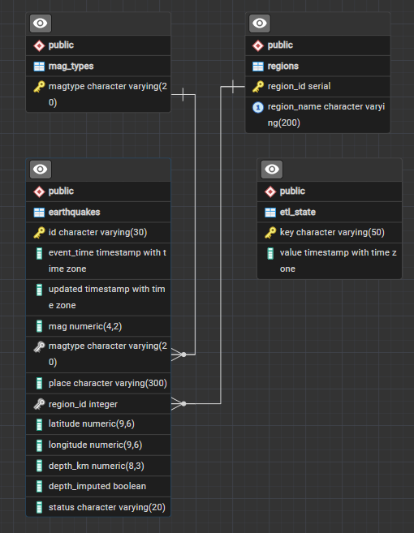
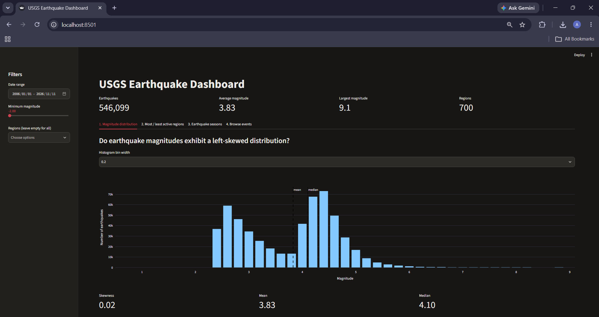
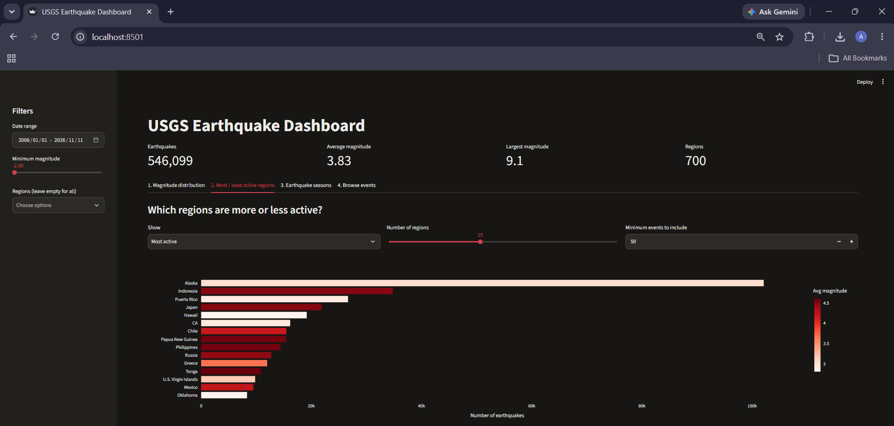
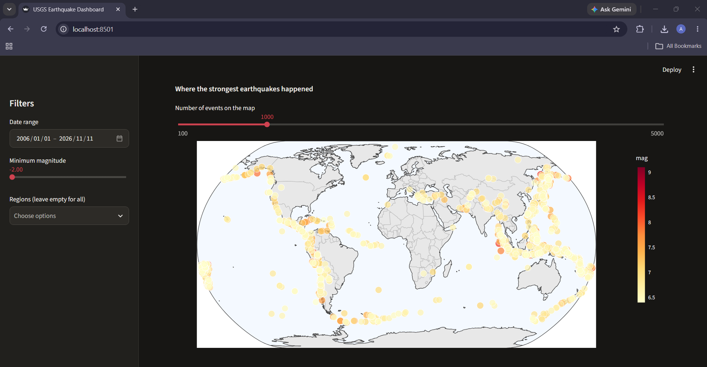
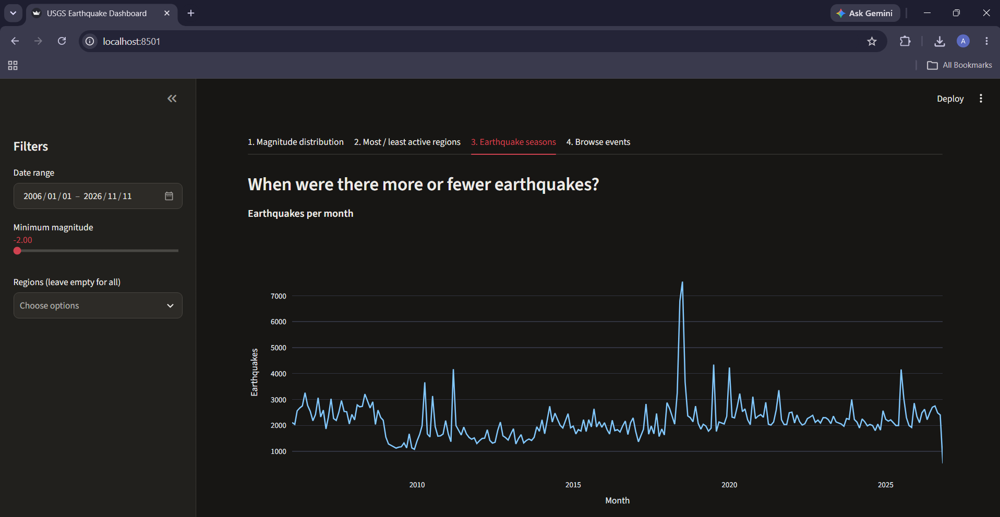
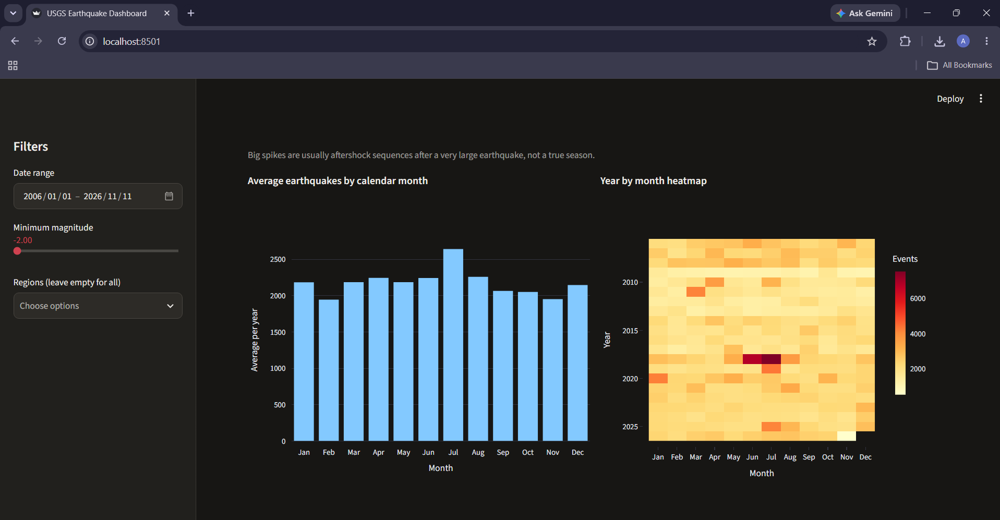
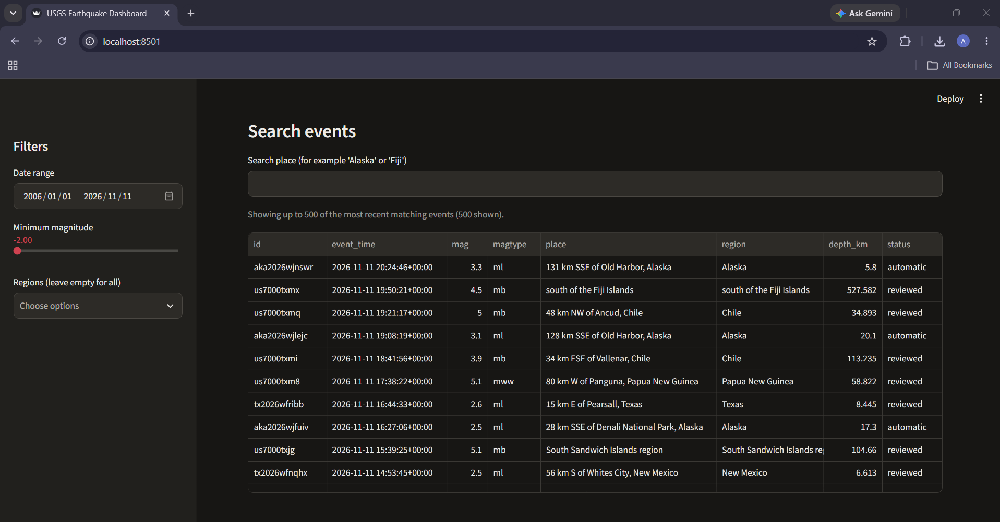

# DAEN328-Earthquake-Dataset

## Overview

- Data source: USGS Earthquake Catalog (FDSN Event Web Service), `https://earthquake.usgs.gov/fdsnws/event/1/`
- Access: free and open, no API key or account required.
- Data: earthquake events from 2006-01-01 to the present, about 566,000 rows in the raw pull and about 546,000 after cleaning. Each event has a time, location, depth, magnitude, magnitude type, place description, review status and a stable event `id`.
- Pipeline: Extract (`extract.py`) -> Transform (`transform.py`) -> Load (`load.py`) -> Dashboard (`streamlit_app.py`), ran via Docker services

### Questions the dashboard answers

1. Do earthquake magnitudes exhibit a left-skewed distribution?
2. Which regions (as a stand-in for fault zones) are more or less active?
3. Over the last 20 years, when were there "seasons" with more or fewer earthquakes?

## How to Run

### Requirements

- Docker Desktop, installed and running
- Git

### Steps

1. **Clone the repository**
   ```
   git clone https://github.com/jacobc-tamu/DAEN328-Earthquake-Dataset.git
   cd DAEN328-Earthquake-Dataset
   ```
2. **Create your `.env` file** from the sample:
   ```
   copy .env.sample .env        # Windows
   cp .env.sample .env          # Mac / Linux
   ```
   Open `.env` and fill in your own database username and password. Keep `POSTGRES_HOST=db`, which is the name of the database service in `docker-compose.yml`.
3. **Build with Docker**
   ```
   docker-compose up --build
   ```
   This will
   1. start PostgreSQL with an empty database,
   2. run the ETL container, which extracts from the USGS API, cleans the data, creates the tables, loads them, and prints the data quality summary,
   3. start the Streamlit dashboard.
4. **Open the dashboard** at http://localhost:8501

The first run pulls the full 2006-to-present dataset and can take several minutes. Wait for the ETL summary to print before opening the dashboard.

### Running again

Stop the stack and start it a second time:

```
docker-compose down
docker-compose up --build
```

`docker-compose down` keeps the database volume. The second run pulls only new or changed records and creates no duplicate rows. For a complete restart, delete the volume with `docker-compose down -v`.


### Environment variables

All configuration comes from `.env` (see `.env.sample`).

| Variable | Meaning |
|---|---|
| `POSTGRES_HOST` | database host. `db` under Docker Compose, `localhost` when running Python files directly |
| `POSTGRES_PORT` | database port (5432 inside Docker) |
| `POSTGRES_DB` | database name |
| `POSTGRES_USER` | database username |
| `POSTGRES_PASSWORD` | database password |

The USGS API needs no key.

## Data Quality Summary

Every ETL run prints a summary to the container log: rows received from the API, rows after cleaning, duplicates removed, missing values handled in each cleaned column, and rows inserted and updated in each table. Example:

**[TODO]** Replace with real output from a run of the final pipeline.

## Transform Step

`transform.py` has one function per cleaning task (standardize text, convert dates and numbers, range-check coordinates and magnitudes, drop rows missing required fields, remove duplicates by keeping the newest revision of each event, filter to earthquakes only, extract a region from the place text, and fill missing depths with the regional median). Missing values are handled column by column rather than dropped automatically. Each function has at least one pytest test in `tests/`.

## PostgreSQL Schema

The cleaned data is loaded into three related tables plus one bookkeeping table. `load.py` creates all of them with `CREATE TABLE IF NOT EXISTS`, so no table is created by hand.



| Table | Primary key | Foreign keys | Contents |
|---|---|---|---|
| `regions` | `region_id` (serial) | none | One row per distinct region, taken from the text after the last comma in the USGS `place` field. `region_name` is UNIQUE. |
| `mag_types` | `magtype` | none | The distinct magnitude types (for example `ml`, `mww`, `mb`). |
| `earthquakes` | `id` (the USGS event id) | `region_id` -> `regions`, `magtype` -> `mag_types` | One row per earthquake: event time, last-updated time, magnitude, place, latitude, longitude, depth, whether the depth was imputed, and review status. |
| `etl_state` | `key` | none | Stores the `last_updated` timestamp of the most recent load, used for incremental pulls. It is not linked to the other tables. |

Normalization. Region names and magnitude types repeat across hundreds of thousands of events, so they live in their own tables and `earthquakes` stores only the keys. Year, month and date are not stored because they can be derived from `event_time`. The `type` column is not stored because only events of type `earthquake` are kept.

Column types. `VARCHAR` for text, `NUMERIC` for magnitude, coordinates and depth, `TIMESTAMPTZ` for times, `BOOLEAN` for the depth-imputed flag, and `INTEGER`/`SERIAL` for surrogate keys.

Writing to the database. `load.py` connects with credentials from `.env`, then upserts `regions` and `mag_types`, then upserts `earthquakes` in batches of 5,000 rows, all in one transaction so a failed load leaves no half-written data. It uses `INSERT ... ON CONFLICT ... DO UPDATE` on each primary key.

## Dashboard

The Streamlit dashboard reads from PostgreSQL through SQLAlchemy. Filters in the sidebar such as date range, minimum magnitude, and regions apply to every chart.

| Tab | Question | Visualizations |
|---|---|---|
| 1. Magnitude distribution | Are magnitudes left-skewed? | Histogram with mean and median lines, plus computed skewness |
| 2. Most / least active regions | Which regions are more or less active? | Bar chart of most or least active regions (query joins `earthquakes` and `regions`), world map of the strongest events |
| 3. Earthquake seasons | When were there more or fewer earthquakes? | Monthly line chart, average by calendar month, year-by-month heatmap |
| 4. Browse events | Detail lookup | Searchable table of recent events |

Dashboard Screenshots:








## Challenges and Known Limitations

**[TODO]** Add challenges/limitations

## Group Members and Contributions

| Member | Email | Contribution |
|---|---|---|
| Jacob Cochran (team leader) | jacobc@tamu.edu | Docker and Docker Compose setup. |
| Kevin Liu | kevinhaoyu@tamu.edu | Transform step: cleaning functions and their tests. Wrote transform.py and test_transform.py |
| Archelaus Paxon | apaxon@tamu.edu | Load step: designed the normalized PostgreSQL schema, wrote load.py, produced the ERD |
| David Stein | dastein007@tamu.edu | Extract step: API pulls with pagination and incremental extraction. Wrote pipeline.ipynb |